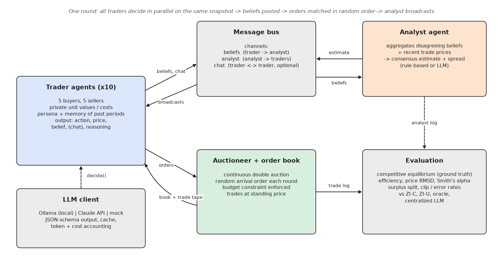
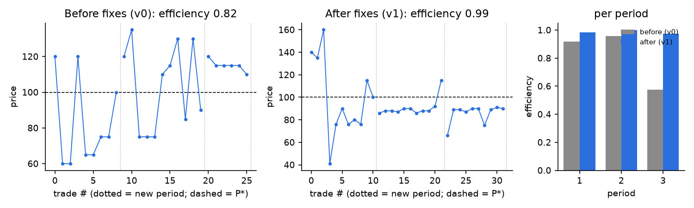

# market-sim: can LLM agents with private information find the market price?

Ten LLM trader agents, each knowing only its own private values or costs, trade a single good in a continuous
double auction. A separate **analyst agent** collects their disagreeing price estimates and broadcasts a
consensus. We measure how close this decentralized multi-agent system gets to the competitive equilibrium,
which we compute exactly, and compare it with random traders and with ablations of each coordination mechanism.

CMPSC 448 final project. All results so far come from a free local model (qwen2.5:3b via Ollama) on a laptop.



## Key findings so far

Main comparison: 3 periods × 6 rounds, symmetric market, qwen2.5:3b, 3 seeds per LLM condition and 10 per
baseline. ± is a 95% interval over seeds; with 3 seeds, treat differences as consistent rather than proven.

| Condition | Efficiency | Buyers' share (competitive: 0.48) |
|---|---|---|
| ZI-C random traders | 0.773 ± 0.027 | 0.50 |
| LLM, no communication | 0.865 ± 0.067 | 0.64 |
| LLM, beliefs shared, no analyst | 0.888 ± 0.062 | 0.60 |
| Centralized LLM planner (sees everything) | 0.926 ± 0.016 | 0.28 |
| **LLM full (analyst + memory)** | **0.945 ± 0.029** | **0.43** |

- **Every LLM condition beats random traders, and each coordination layer adds efficiency.** No communication
  0.865, shared beliefs 0.888, full system with the analyst 0.945. The full system was also the most stable:
  its worst seed (0.922) beat both ablations' averages. The same holds after a supply shock (0.934 vs ZI-C 0.748).
- **The analyst helps, but leans on a safety net.** With the analyst, agents tried nearly three times as many
  loss-making orders (14% vs 5%), pricing toward the consensus past their own value. The budget constraint
  blocked these.
- **Prompt and protocol fixes turned a losing market into a near-perfect one** (seed 0, 10 rounds per period). Efficiency rose
  from **0.817 to 0.986**, above every one of 10 random-trader (ZI-C) seeds (mean 0.889). The fixes: filtering
  nonsense price beliefs, showing agents the profit arithmetic, and warning that the analyst can be wrong.
- **Many agents with partial information match or beat one agent that sees everything.** Given every trader's private
  values and costs, a single qwen2.5:3b "central planner" picked a price of 115 in 13 of 15 periods (true
  equilibrium: 100) and reached **0.926 ± 0.016** efficiency over 5 seeds. The decentralized market did at least as well
  (0.945) without any agent seeing the whole picture.
- **Coordination can backfire.** In the first version, agents herded on a wrong analyst consensus (115 vs a
  true price of 100), and efficiency in the final period collapsed to 0.57.
- **Agreement isn't the same as competitive pricing.** After the fixes, prices converged tightly, but to about
  88–90 rather than 100, and buyers captured **62%** of the surplus instead of the competitive **48%**. Agents
  anchored on the analyst more often (18% → 24% of orders), so the consensus became self-fulfilling.
- **Small models make basic economic mistakes.** 12–18% of orders would have bought above value or sold below
  cost, and reasoning text often contradicts the numbers it cites.



## How it works

- **Market** (`market/`): continuous double auction with price-time priority. Trades execute at the standing
  order's price. A budget constraint blocks loss-making trades and records each attempt. Each session has 3
  periods; endowments reset each period, while agent memory carries over.
- **Rounds**: every trader sees the same snapshot and decides in parallel, then orders arrive in random order,
  so results don't depend on how fast each model responds.
- **Agents** (`agents/`): LLM traders return schema-constrained JSON with an action, a price, a belief about
  the equilibrium price and short reasoning. The analyst blends recent trade prices with the median belief and
  reports how much traders disagree. Baselines: ZI-C and ZI-U random traders, an exact-equilibrium oracle, and a
  centralized LLM planner.
- **Communication** (`comms/bus.py`): `beliefs`, `analyst` and optional `chat` channels. Every message is
  logged.
- **LLM client** (`llm/client.py`): Ollama, Claude API or mock backend, with an on-disk response cache,
  token accounting and tolerant JSON parsing.
- **Evaluation** (`analysis/`): efficiency, price RMSD, Smith's α, surplus split, rationality rates, figures,
  reasoning excerpts and an architecture diagram.

## Quickstart

```bash
git clone https://github.com/itsanushkah/market-sim.git && cd market-sim
python3 -m venv .venv && source .venv/bin/activate
pip install -r requirements.txt
pytest                                   # 24 tests, no model needed
```

Pick an LLM backend with `--backend`:

| Backend | Cost | Setup | Use for |
|---|---|---|---|
| `ollama` | free, local | install [Ollama](https://ollama.com), then `ollama pull qwen2.5:3b` | all reported results |
| `anthropic` | paid | `export ANTHROPIC_API_KEY=...` | stronger-model runs |
| `mock` | free, instant | none | tests and pipeline checks only; **not an LLM, never a result** |

```bash
# One run of the main condition on the local model (about 1-4 h on an 8 GB laptop)
python -m experiments.runner --config experiments/configs/main/llm_full.yaml --backend ollama --model qwen2.5:3b --seeds 0

# Short test run: 1 period, 6 rounds, saved under a separate name
python -m experiments.runner --config experiments/configs/main/llm_full.yaml --backend ollama --model qwen2.5:3b \
  --seeds 0 --periods 1 --rounds 6 --name-suffix _test

# Full laptop plan: matched baselines + 4 LLM conditions x 3 seeds (restartable; finished runs are skipped)
caffeinate -i bash experiments/run_laptop_plan.sh

# Tables, figures, reasoning excerpts
python -m analysis.metrics results       # mean ± 95% CI per condition, writes results/summary.csv
python -m analysis.plots                 # report/figures/*.png (mock runs excluded)
python -m analysis.excerpts results/llm_full_qwen3b_v1/seed_0
python -m analysis.diagram               # architecture figure

# Demo: replays logged runs, never calls a model
streamlit run dashboard/app.py
```

LLM responses are cached in `.llm_cache/`, so re-running a seed costs nothing and gives the same result.

## Experimental conditions

| Group | Config | What it tests |
|---|---|---|
| Baselines | `zi_c`, `zi_u` | random traders with and without the budget constraint (Gode & Sunder 1993) |
| | `centralized_oracle`, `centralized_llm` | exact equilibrium; one LLM that sees all private information |
| Main | `llm_full` | LLM traders + analyst + memory |
| Ablations | `no_analyst`, `no_memory`, `no_comms` | the value of each coordination mechanism |
| | `analyst_llm`, `chat`, `personas_mixed`, `mixed_population` | LLM analyst, cheap talk, heterogeneous styles, LLMs vs ZI |
| Robustness | `shock`, `asymmetric`, `random_markets` | regime change, lopsided surplus, unseen markets |

Markets are in `market/configs/`. Main market: 5 buyers and 5 sellers with 3 units each; equilibrium
Q\* = 11, P\* = 100, maximum surplus 600.

## Repository layout

```
market/        order book, auctioneer (round loop), market configs, equilibrium calculator
agents/        LLM trader, analyst, ZI traders, centralized planner, personas, shared interface
comms/         message bus (beliefs / analyst / chat channels)
llm/           LLM client: Ollama, Claude API, mock; cache; usage tracking
experiments/   runner, YAML configs, laptop experiment plan
analysis/      metrics, plots, diagram, reasoning excerpts, metric recompute
dashboard/     Streamlit replay of logged runs
tests/         order book, equilibrium, end-to-end runs, LLM client
results/       <experiment>/seed_<k>/: config, market, orders (with reasoning), trades, messages, metrics
report/        draft, outline, lessons log, figures, excerpts
```

## Limitations

A 3B-parameter local model, 3 seeds per LLM condition (each run takes 10 min to 6 h on a laptop), and a budget
constraint that keeps agents from losing money even when they try to. See `report/draft.md` §3.7.
