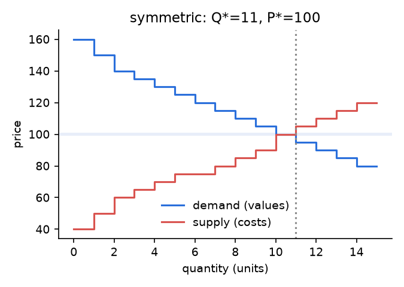
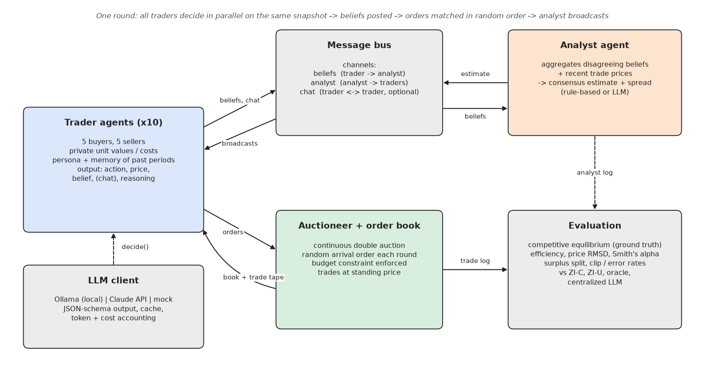
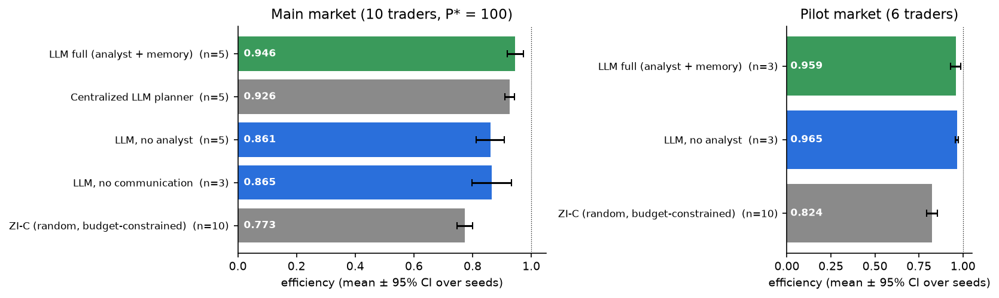
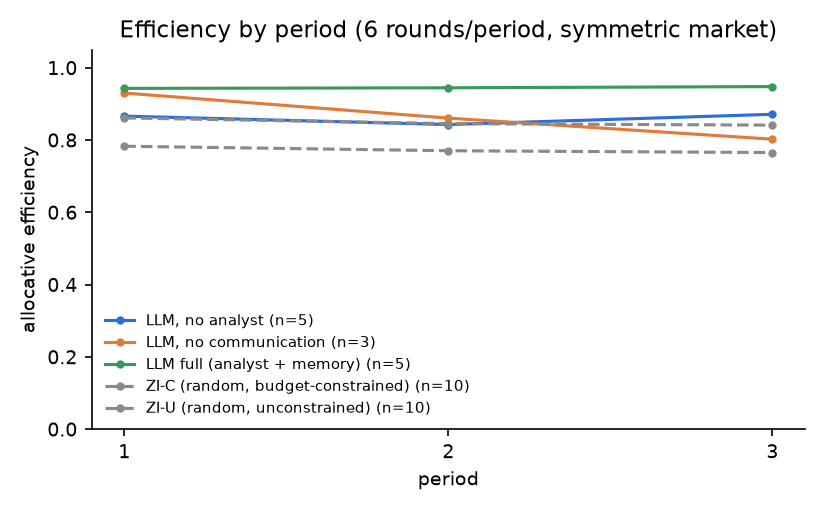
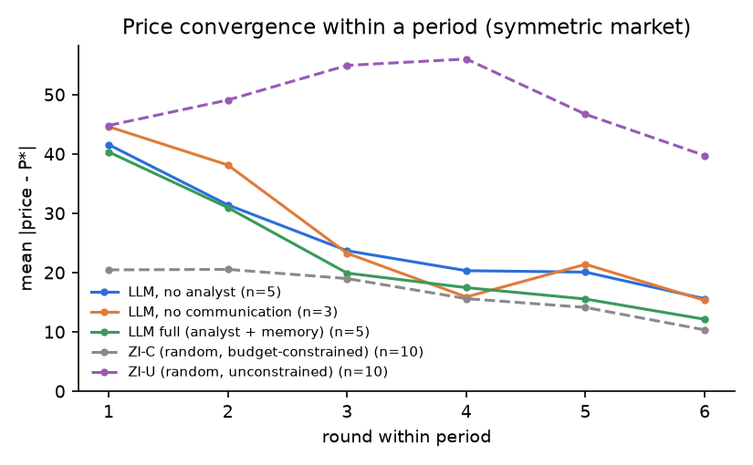

CMPSC 448 Final Project: Multi-Agent AI for Solving Real-World Problems

<strong>Team leader:</strong> Anushka Shrivastava (individual project)

<strong>Code:</strong> github.com/itsanushkah/market-sim &nbsp;·&nbsp; <strong>Demo:</strong> Streamlit dashboard (<code>streamlit run dashboard/app.py</code>)

December 2026

**Abstract.** Markets are a real-world case where the information needed to make a good decision is split
across many parties: each buyer knows only what a good is worth to them and each seller only what it costs
them, and nobody sees the whole supply and demand picture. We build a multi-agent system in which ten
LLM trader agents (a local 3B-parameter model, qwen2.5:3b) trade one good in a continuous double auction,
and a separate analyst agent collects their conflicting price estimates and broadcasts a consensus. Because
the competitive equilibrium of each simulated market is known exactly, we can measure how much of the
possible gains from trade the agents capture (allocative efficiency), how close prices get to equilibrium, and
how quickly. Over 5 independent runs the full system reaches 0.946 ± 0.028 efficiency, against 0.773 for
random budget-constrained traders, 0.861 without the analyst and 0.926 for a single LLM that is given every
trader's private information and asked to set the price. The analyst is the component that makes the
difference (Welch t ≈ 3.0, p ≈ 0.02 against the no-analyst ablation), but only in the 10-trader market: in a
6-trader pilot market it adds nothing. The agents trade the right units but do not settle on the right price
within a session, and the analyst makes them try more than twice as many loss-making orders. We report
these trade-offs together with the failures we found and fixed along the way.

## 1. Problem and why a multi-agent design

### 1.1 The problem: price discovery with private information

Every market has to answer the same question: at what price should a good change hands, and who should
trade? Economics gives a clean answer, the *competitive equilibrium*: the price P\* at which the quantity
buyers want equals the quantity sellers offer. At P\* every unit that is worth more to a buyer than it costs a
seller gets traded, and no other unit does, so the total gain from trade (the *surplus*) is as large as it can
be. The difficulty is that nobody can compute P\* directly. It depends on every buyer's private value and every
seller's private cost, and those are spread across many people who have reasons not to reveal them.

Real markets solve this by interaction: people post bids and asks, watch what trades, and adjust. The same
problem appears wherever decisions depend on information that is distributed and private: setting prices in
online marketplaces and ad auctions, allocating cloud computing or electricity, or matching supply and demand in
procurement. As LLM agents start to act for people in such settings (shopping agents, negotiation agents,
procurement bots), it becomes a practical question whether a population of them, each knowing only its
owner's information, can reach good collective outcomes, and what kind of coordination helps them get there.

We study this question in a controlled setting where the right answer is known. Each simulated market is
defined by step supply and demand curves (Figure 1), so P\*, the equilibrium quantity Q\* and the maximum
surplus are computed exactly, and every outcome can be scored against ground truth.

{width=55%}

### 1.2 Why a multi-agent system

The problem is multi-agent by construction rather than by choice of architecture:

1. **Information is decentralized.** Each trader holds private information that no other component has. A
   single agent can only solve the problem if someone first collects all private values and costs, which in a
   real market nobody can do (people would misreport them, and collecting them is the hard part).
2. **Agents have conflicting goals.** Buyers want low prices and sellers want high ones. Each agent acts for
   its own owner, so the system must produce a good *collective* outcome from self-interested parts.
3. **Coordination is the object of study.** The market mechanism (order book) and the analyst agent are
   coordination devices. A multi-agent design lets us switch each one on and off and measure its effect.
4. **There is a single-agent alternative to compare against.** We give one LLM *all* the private information
   and ask it to set the clearing price. If the decentralized system matches or beats it while no agent sees
   the whole market, that is direct evidence that splitting the problem across agents helps.

### 1.3 Research questions

- **RQ1.** Do LLM trader agents with private information reach efficient outcomes, and how do they compare with
  zero-intelligence random traders (a classic baseline from experimental economics)?
- **RQ2.** Which coordination mechanisms matter? In particular, does an analyst agent that aggregates the
  traders' conflicting price estimates improve the outcome, and does that depend on market size?
- **RQ3.** Beyond efficiency: how close do prices get to P\*, how quickly do they converge, and who captures the
  surplus (buyers or sellers)?
- **RQ4.** How does the decentralized system compare with a single centralized LLM that sees everything?

## 2. System design and implementation

### 2.1 Overview

The system is a simulated market for a single good in which ten LLM-driven trader agents (five buyers, five
sellers) trade through a continuous double auction (CDA). Each trader knows only its own private unit values
(buyers) or unit costs (sellers). No agent can see the supply and demand curves, so the competitive
equilibrium can only be discovered through interaction. A separate analyst agent never trades. It collects the
traders' (often conflicting) estimates of the equilibrium price and broadcasts a single consensus estimate,
which is the main coordination mechanism we study.

Figure 2 shows the components and the information flow between them.

### 2.2 Agents and roles

| Agent | Count | Sees | Produces |
|---|---|---|---|
| LLM trader | 10 (5 buyers, 5 sellers) | own remaining unit values/costs; best bid/ask; last 10 trade prices; analyst broadcasts; optional chat; its own notes from previous periods | `action` (bid / ask / pass), `price`, `belief` (estimate of the equilibrium price), optional public `message`, short `reasoning` |
| Analyst | 1 | all trade prices; all traders' posted beliefs for the round | consensus price estimate and belief spread, broadcast to all traders |
| Zero-intelligence trader (baseline) | 10 | own unit value/cost only | uniformly random price; ZI-C respects the budget constraint, ZI-U does not (Gode & Sunder, 1993) |
| Centralized planner (baseline) | 1 | every trader's private values and costs | a single market-clearing price |

**Trader prompt.** The system prompt states the market rules and a persona (rational, cautious, aggressive or
trend-following; the main condition uses "rational"). Each round the user prompt lists the trader's next
unit value or cost, the order book, recent prices, messages and, when memory is on, up to three notes
summarizing earlier periods (average price, units traded, cumulative profit). Agents return JSON constrained
by a schema, so every response either parses into a valid action or is counted as an error, and the agent
passes for that round.

**Memory.** At the end of each period every LLM trader appends a one-line note with the period's trade count,
average and range of prices, the units it traded and its cumulative profit. Notes are written by code, not by
the model, so memory adds no extra LLM calls.

### 2.3 Market mechanism

- **Order book.** Each trader holds at most one standing order; a new order replaces the old one. A bid at or
  above the best ask (or an ask at or below the best bid) trades immediately at the *standing* order's price.
  Ties use price-time priority. As in Gode & Sunder, the book is cleared after every trade.
- **Rounds.** In each round every trader that still has units observes the *same* snapshot and decides in
  parallel. Orders then enter the book in a random order. This makes the outcome independent of how fast each
  LLM call returns.
- **Budget constraint.** A buyer's bid above its value (or a seller's ask below its cost) is clipped to the
  value or cost and logged as a violation. This prevents losses and lets us measure how often agents *try* to
  trade irrationally.
- **Periods.** A session has 3 periods. Unit endowments reset each period while agent memory persists, so
  agents can learn across periods. The shock condition shifts every value and cost by +30 at the start of
  period 3.

### 2.4 Collaboration protocol and disagreement resolution

Agents communicate through a message bus with three channels (`comms/bus.py`). All messages are logged.

1. **beliefs** (trader to analyst): every trader posts its estimate of the equilibrium price each round.
   Beliefs outside the allowed price range (for example 0) are discarded before the analyst sees them.
2. **analyst** (analyst to traders): after each round the analyst resolves the disagreement between beliefs
   into one estimate. The rule-based analyst takes 0.6 × median of the last five trade prices + 0.4 × median
   belief (only the belief median before any trade has happened) and reports the spread (IQR) of beliefs, so
   traders can see how strongly the market agrees. An LLM analyst variant writes the estimate and a summary
   from the same inputs.
3. **chat** (trader to trader, optional): public, non-binding messages. This channel is off in the main
   condition and on in the `chat` ablation.

#### The analyst's role in detail

*What it can access.* Only public or volunteered information: (a) the prices of completed trades, which every
trader also sees, and (b) the price estimate ("belief") that each trader posts on the `beliefs` channel each
round. It cannot see any trader's private values or costs, the reasoning text, or unfilled orders. It never
trades and has no stake in the price. This matters for the comparison in 3.6: the centralized planner sees all
30 private numbers, while the analyst sees none of them.

*What it does with them.* The two sources answer the same question (what is the market price?) in different
ways. Trade prices are hard evidence, but there are few of them early in a period and early trades are often far
from equilibrium. Beliefs are available from round 1 but are guesses from a small model. The rule-based analyst
used in all main results combines them as

    estimate = 0.6 × median(last 5 trade prices) + 0.4 × median(valid beliefs this round)

and uses the belief median alone before the first trade. If no source is available it repeats its last estimate.

*When sources agree or conflict.*

| Situation | What the analyst does |
|---|---|
| Traders' beliefs agree with each other | Small spread (IQR) is broadcast, signalling a firm consensus |
| Traders' beliefs conflict | The median is used, so a minority of extreme beliefs cannot move the estimate; the IQR is broadcast so traders can see the disagreement and discount the estimate |
| Invalid beliefs (0, negative, above the price cap) | Removed by the auctioneer before the analyst reads them |
| Beliefs conflict with trade prices | Trades get the larger weight (0.6), because they are commitments rather than opinions; the estimate moves toward beliefs only partly |
| A few outlier trades (e.g. an opening trade at 41 or 160) | Median of the last five trades, so one or two outliers are ignored |

The broadcast is one line, e.g. "Consensus equilibrium estimate: 104.2; traders disagree by about 12.0 (IQR).
Recent trades: [...]". Traders read it the next round and are told it "is a summary of other traders' guesses
and may be wrong". Every estimate, spread and number of beliefs used is logged in `analyst.json`.

*Known weakness.* The analyst can only be as good as its inputs. If most traders share the same wrong belief,
the median is wrong too, and broadcasting it reinforces the error (the herding episode in 2.5 and Section 4). An LLM analyst
variant (`analyst_llm`) receives the same inputs and writes the estimate itself; it is implemented but not
included in the reported runs.

### 2.5 Optimization of the collaboration

We changed the system in response to measured failures (full log in `report/lessons_log.md`):

| Problem observed in run v0 | Change in v1 |
|---|---|
| Many traders posted belief = 0; the analyst averaged these in and broadcast estimates of 54–69 (P\* = 100) | Out-of-range beliefs are filtered before aggregation; the prompt requires a realistic belief |
| Agents traded at exactly their own value or cost, earning nothing | The prompt states the profit arithmetic for accepting the current quote (e.g. "95 − 60 = 35, a profit") |
| Herding: in period 3 all agents anchored on the analyst's 115 and only 6 of 11 efficient trades happened | The prompt notes that the analyst's estimate is a summary of other traders' guesses and may be wrong |
| ~36 s per call on the laptop | Shorter reasoning field, 200-token output cap, model kept loaded between calls, calls run sequentially (8 parallel calls were slower on 8 GB of RAM) |
| The output cap truncated 23% of answers | A lenient parser closes a cut-off trailing `reasoning` string when every required field is present |

Other engineering choices that reduce cost and make runs reproducible: an on-disk cache keyed on the full
request (re-running a seed costs nothing), JSON-schema-constrained output, seeded randomness for markets and
agent order, and a free mock backend used only for tests.

### 2.6 Implementation details

- Python 3.11, about 2,600 lines across `market/`, `agents/`, `comms/`, `llm/`, `experiments/`, `analysis/`,
  `dashboard/` and `tests/`. 26 unit and end-to-end tests (market, agents, runner, analysis pipeline, dashboard) run without a model.
- LLM backends: local open-weight model through Ollama (qwen2.5:3b, used for all reported results because of
  budget), the Claude API (implemented, not used for results) and the mock backend.
- Each run writes its config, market, every order (with the agent's reasoning), trades, bus messages, analyst
  history, LLM usage and metrics to `results/<experiment>/seed_<k>/`.
- A Streamlit dashboard (`dashboard/app.py`) is used for the demo. It has four tabs: a plain-language
  explanation with the headline results; a **live run** that starts a small market on the local model and shows
  each agent's decision, reasoning and every trade as it happens (about 15 s per decision, so a 24-decision demo
  takes about 6 minutes); a **replay** of any logged run round by round, which needs no model and cannot fail;
  and a comparison of all conditions.

## 3. Evaluation

### 3.1 Markets ("dataset")

| Market | Traders | Competitive equilibrium | Purpose |
|---|---|---|---|
| Symmetric (hand-built) | 5 buyers × 3 units, 5 sellers × 3 units | Q\* = 11, P\* = 100, max surplus 600 | main condition |
| Shock | same as symmetric, all values/costs +30 from period 3 | P\* = 100, then 130 | adaptation to a regime change |
| Asymmetric | flat demand, steep supply | Q\* = 10, P\* = 145, max surplus 887 | bias toward a "fair" midpoint price |
| Random | values U[60,160], costs U[40,140], new market per seed | varies | generalization |

Because the competitive equilibrium is computed exactly (`market/equilibrium.py`), every run has ground
truth.

### 3.2 Metrics

- **Allocative efficiency**: realized surplus divided by maximum possible surplus (1.0 = every efficient unit
  traded and no inefficient one did).
- **Price RMSD**: root-mean-square deviation of trade prices from P\*; **Smith's α** = 100 × RMSD / P\* in the
  final period (convergence).
- **Convergence speed**: for each period, the first round from which every later trade is within ±10% of P\*
  (`converge_round`; a period that never settles counts as rounds + 1), the share of trades made after that
  point (`settled_share`), and the mean |price − P\*| in each round (`convergence_by_round.png`).
- **Share of trades inside the equilibrium price band**, **quantity ratio** (units traded / Q\*) and
  **extramarginal trades** (units that should not trade at P\*).
- **Buyers' share of surplus**, compared with the share they would get at P\*.
- **Agent rationality**: budget-violation (clip) rate, zero-profit orders and invalid/error rate, with
  per-category reasoning excerpts (`analysis/excerpts.py`).
- **Cost**: LLM calls, tokens and wall-clock time per run.

### 3.3 Baselines and conditions

- **ZI-C / ZI-U**: random traders with and without the budget constraint.
- **Oracle**: the exact equilibrium price (upper bound).
- **Centralized LLM**: the same model (qwen2.5:3b) sees every trader's private values and costs and sets one
  clearing price per period; all units that want to trade at that price trade. 5 seeds, response cache off, so
  each seed is an independent sample.
- **Ablations** of the coordination mechanisms: `no_analyst` (no consensus broadcast), `no_comms` (no analyst,
  no memory, no chat; agents interact only through the order book).

**Protocol.** Model qwen2.5:3b through Ollama on an 8 GB MacBook Air. Main comparison: 3 periods × 6 rounds,
seeds 0–4 for the full system and the no-analyst ablation, seeds 0–2 for the other LLM conditions, seeds 0–9
for the random baselines (they cost nothing to run). Earlier prompt-development runs used
10 rounds per period and are reported separately in 3.5 because session length changes efficiency (ZI-C: 0.889
at 10 rounds vs 0.773 at 6).

### 3.4 Main results (6 rounds per period, symmetric market)

| Condition | Seeds | Efficiency | Price RMSD | Buyers' share (P\* share 0.483) |
|---|---|---|---|---|
| Oracle | 1 | 1.000 | 0.0 | 0.483 |
| Centralized LLM (full information) | 5 | 0.926 ± 0.016 | 15.3 | 0.282 |
| ZI-C | 10 | 0.773 ± 0.027 | 22.3 ± 2.5 | 0.502 ± 0.043 |
| ZI-U | 10 | 0.850 ± 0.022 | 56.7 ± 2.5 | 0.470 ± 0.145 |
| LLM full (analyst + memory) | 5 | **0.946 ± 0.028** | 29.7 ± 1.5 | 0.492 ± 0.094 |
| LLM, no analyst | 5 | 0.861 ± 0.047 | 30.1 ± 1.7 | 0.559 ± 0.050 |
| LLM, no communication | 3 | 0.865 ± 0.067 | 33.1 ± 4.3 | 0.637 ± 0.059 |

± is a 95% confidence interval over seeds (normal approximation; a t-based interval would be about 1.4 times
as wide with 5 seeds and about twice as wide with 3). Per-seed efficiency: LLM full 0.922 / 0.942 / 0.972 / 0.908 /
0.983; no analyst 0.917 / 0.825 / 0.922 / 0.825 / 0.814; no communication 0.931 / 0.847 / 0.817. Shock market: ZI-C 0.748 ± 0.032, LLM full
0.934 ± 0.053 (0.981 / 0.936 / 0.886).

| Behaviour (share of decisions, seeds pooled: 5 / 5 / 3) | LLM full | No analyst | No comms |
|---|---|---|---|
| Would have traded at a loss (clipped) | 13.1% | 5.5% | 5.0% |
| Priced at exactly own value/cost | 10.6% | 11.8% | 14.9% |
| Anchored on the analyst's estimate | 13.7% | n/a | n/a |
| Accepted the opposite quote at a profit | 12.2% | 10.2% | 10.1% |

{width=62%}

Every LLM condition beats ZI-C on average at the same session length (0.861–0.946 vs 0.773), and every LLM
seed is above the ZI-C mean. The gain from coordination comes from the analyst, not from sharing beliefs alone:
no communication 0.865 (3 seeds), belief sharing without an analyst 0.861 (5 seeds), full system 0.946 (5 seeds).
The full system is also the most stable: its lowest seed (0.908) is above the mean of both ablations, and no
period drops below 0.87, while both ablations have periods at 0.70–0.78. With 5 seeds the full-system and
no-analyst intervals no longer overlap (0.918–0.974 vs 0.814–0.908); a Welch t-test on the per-seed values gives
t ≈ 3.0, p ≈ 0.02. That is reasonable evidence for the analyst's effect in this market, but it rests on 5 runs
per condition, and the wider t-based intervals do overlap slightly. The effect on *who* gains is weaker than it
looked with 3 seeds: buyers take 56% of the surplus without the analyst and 49% with it (competitive: 48%), but
the full system's split varies a lot between seeds (0.37 to 0.66) and the intervals overlap. One caveat cuts the
other way: agents with the analyst attempt more than twice as many loss-making orders (13.1% vs about 5%), because they price toward the
consensus even when it lies beyond their own value or cost. The budget constraint clips these orders, so part of
the analyst's benefit depends on that safety net. Price RMSD is higher for all LLM conditions than for ZI-C
(about 30 vs 22), because LLM agents open each period with extreme quotes (41, 160) that sometimes trade.

**Convergence speed.** Efficiency and price convergence turn out to be different things here (Figure 5).

{width=62%}

| Condition | Round at which prices settle (of 6; 7 = never) | Trades made after settling | Mean \|price − P\*\| in rounds 1–2 → 5–6 |
|---|---|---|---|
| ZI-C | 6.0 ± 0.6 | 10% | 20 → 12 |
| LLM, no communication | 6.2 ± 0.8 | 5% | 42 → 18 |
| LLM, no analyst | 6.5 ± 0.3 | 6% | 36 → 18 |
| LLM full (analyst + memory) | **5.9 ± 0.4** | **12%** | 35 → 14 |

No condition reliably converges within 6 rounds: most periods end before all trades are within 10% of P\*. LLM
traders start each period much further from equilibrium than random traders (opening quotes near 41 and 160),
then close most of the gap by round 3. The full system settles slightly earlier and about twice as many of its
trades happen at near-equilibrium prices compared with the ablations, but 12% is still low and no better than
ZI-C's 10%. So the LLM market's
advantage over ZI-C is in *who trades* (efficiency), not in *price accuracy*. Longer sessions did not fix this: with 10 rounds per
period (3.5) prices clustered tightly, but around 88–90 rather than P\* = 100, so only 9% of trades counted as
settled. More rounds produced agreement, not accuracy.

**Small-market pilot** (TA recommendation). Same protocol on a much smaller market: one good, 3 buyers and
3 sellers with 2 units each (`market/configs/pilot.yaml`; Q\* = 4, P\* = 95–105, maximum surplus 255 per
period). Experiments: `experiments/run_pilot.sh`.

| Condition (6 traders, 6 rounds per period) | Seeds | Efficiency | Price RMSD | Buyers' share (P\* share 0.49) | Round at which prices settle |
|---|---|---|---|---|---|
| ZI-C | 10 | 0.824 ± 0.031 | 21.3 | 0.49 | 5.4 |
| LLM, no analyst | 3 | 0.965 ± 0.009 | 25.8 | 0.52 | 4.4 |
| LLM full (analyst + memory) | 3 | 0.959 ± 0.030 | 29.8 | 0.58 | 4.7 |

The pilot agrees with the 10-trader market on the main point: LLM traders capture more of the gains than random
traders (0.96 vs 0.82), and every LLM seed beats the ZI-C average. It disagrees on the analyst: in the small
market the analyst makes no measurable difference (0.959 with, 0.965 without; per-seed 0.987 / 0.935 / 0.954 vs
0.961 / 0.974 / 0.961), and prices settle no sooner with it. A plausible reason is that with only 6 traders and
4 units to trade there is little dispersed information to aggregate: a trader learns almost as much from the few
quotes it sees as from a consensus of five other guesses. The analyst's benefit in 3.4 (0.946 vs 0.861) appeared
with 10 traders and 11 units. So the evidence so far is that the coordinating agent helps more as the market
grows, which would need a third, larger market to confirm. As in the larger market, agents with the analyst
attempted more loss-making orders (17% vs 11%).

### 3.5 Effect of the prompt and protocol fixes (10 rounds per period, seed 0)

| | v0 | v1 | ZI-C (10 seeds) |
|---|---|---|---|
| Efficiency | 0.817 | **0.986** | 0.889 ± 0.014 |
| Efficiency by period | 0.92 / 0.96 / 0.57 | 0.98 / 1.00 / 0.97 | |
| Price RMSD | 24.1 | 22.8 | 21.0 |
| Trades (Q\* = 11 per period) | 26 | 32 | |
| Buyers' share of surplus (P\* share 0.483) | 0.520 | 0.621 | 0.481 ± 0.037 |
| Orders that would have lost money | 17.5% | 11.7% | n/a |
| Orders at exactly own value/cost | 12.0% | 5.5% | |
| Orders anchored on the analyst's estimate | 17.9% | 23.7% | |
| Wall time | 2.7 h | 3.9 h | seconds |

The fixes removed the period-3 collapse and raised efficiency above every ZI-C seed. They also made agents rely
more on the analyst: prices converged tightly, but to about 88–90 rather than P\* = 100, and buyers captured
62% of the surplus instead of 48%. The analyst's consensus became self-fulfilling, so the market coordinated on
*a* price rather than on *the* competitive price. This is a single seed, so the comparison is suggestive, not
statistically established.

### 3.6 Centralized vs decentralized

The centralized planner sees everything the market as a whole knows, so it could in principle compute P\* = 100
exactly. Instead it chose 115 in 13 of 15 periods (100 once, 120 twice), reaching 0.926 ± 0.016 efficiency and
handing most of the surplus to sellers (buyers' share 0.28 against 0.48 at P\*). Its explanations state that 115
"maximizes total surplus" while the sums it writes out are wrong. The decentralized market, in which no agent
sees more than its own units, did better (0.986 in v1). The task the single model fails at, aggregating 30
private numbers into one price, is done implicitly by the trading process and the analyst. This is the clearest
evidence in the project that splitting the problem across agents helps. Caveat: the planner's efficiency does
not depend on session length, while the v1 comparison is one seed at 10 rounds; at 6 rounds per period the decentralized
market (0.946 ± 0.028, 5 seeds) still beats the planner (0.926 ± 0.016), but the intervals overlap, so the
claim is "at least as good, with no agent seeing the whole market", not "clearly better".

### 3.7 Qualitative observations

From the logged reasoning of every order (`report/excerpts/`):

- Agents often cite the analyst's estimate and price within a few units of it, even when their own value
  implies a very different price.
- Reasoning text is frequently inconsistent with the numbers in the prompt (it quotes an analyst estimate of
  88.08 when the broadcast was 88.02, or calls a zero-profit order "maximizing profit").
- Some apparently irrational bids (bid = own value) still earned a profit, because the CDA fills at the
  standing ask. Rules that protect agents can hide poor reasoning.

### 3.8 Threats to validity

- Small model (3B parameters); results may not transfer to stronger models.
- Few runs per LLM condition (5 for the full system and the no-analyst ablation, 3 for the others) because each
  run takes 20 minutes to several hours on the available hardware. The 95% intervals use a normal
  approximation; t-based intervals would be wider.
- Shorter sessions (6 rounds) disadvantage every condition; all comparisons in 3.4 use the same length.
- The rule-based budget constraint prevents losses, so efficiency partly reflects the mechanism, not the
  agents. The clip rate reports how often it intervened.
- Two market sizes only (6 and 10 traders); the claim that the analyst helps more in larger markets needs a
  third, larger market to confirm.
- The rule-based analyst was used for all reported runs; the LLM analyst variant is implemented but untested.

## 4. Lessons and experience

**1. Coordination can make things worse before it makes them better.** Our first full run (v0) was *less*
efficient than random traders (0.817 vs 0.889 at 10 rounds per period). The cause was the coordination layer
itself: many traders posted a belief of 0, the analyst averaged these in and broadcast estimates of 54–69 for
a market whose equilibrium is 100, and by the third period every agent anchored on a confident but wrong
consensus of 115. Only 6 of the 11 efficient trades happened (period efficiency 0.57). Adding a channel for
agents to share information also adds a channel for errors to spread. A coordinator needs input validation
and needs to tell agents how uncertain it is.

**2. Small, targeted fixes to the prompt and protocol mattered a lot.** We could not use a larger model,
so we fixed the failures one at a time: filter out-of-range beliefs, show agents the profit arithmetic of
accepting the current quote ("95 − 60 = 35, a profit"), and say that the analyst "may be wrong". Efficiency on
the same seed went from 0.817 to 0.986 (Section 3.5). The lesson for us was to read the agents' reasoning, not just
the metrics: the zero-profit orders and the herding were obvious in the logs long before we had a metric for them.

**3. Improvements can move the problem rather than solve it.** The fixes made agents more rational *and* more
dependent on the analyst. Prices then converged tightly, but to 88–90 instead of 100, and buyers took 62% of
the surplus instead of 48%. The analyst's estimate became self-fulfilling: the market agreed on *a* price, not
*the* price. That is why we report price accuracy, convergence and the surplus split alongside efficiency
(TA recommendation 3): efficiency alone would have hidden this.

**4. Don't tell a story from one seed, in either direction.** With seed 0 only, the analyst looked useless
(0.922 with it vs 0.917 without). With three seeds it looked like each coordination layer added efficiency
step by step. With five seeds the analyst effect became clear (0.946 vs 0.861, p ≈ 0.02), while the "step by
step" story turned out to be wrong: sharing beliefs without an analyst (0.861) is no better than no
communication (0.865). We rewrote our conclusions twice. Running more seeds was the single most useful thing
we did for the evaluation, and the per-seed numbers are in the report so readers can judge the spread themselves.

**5. A result in one market may not hold in another.** Following the TA's suggestion to start with a small
pilot, we ran a 6-trader market. LLM traders still beat random ones there (0.96 vs 0.82), but the analyst made
no difference. Without the pilot we would have claimed the analyst helps in general; the honest claim is that
it helped when there was more scattered information to combine.

**6. Safety rails hide poor reasoning.** The budget constraint clips any order that would lose money. Without
it, agents with the analyst would have made a loss-making order 13% of the time (vs 5% without). Part of the
analyst's benefit therefore depends on the mechanism stopping agents from following it too far. We log every
clipped order so this is visible rather than hidden.

**7. A single LLM with all the information is not automatically better.** We expected the centralized planner
to be an upper bound. Instead it picked 115 in 13 of 15 periods and wrote out surplus sums that were wrong.
Aggregating 30 private numbers into one price is exactly the step a small model gets wrong, and the market
does it implicitly through trading.

**8. Engineering lessons.** (a) No API budget meant running a 3B model locally on an 8 GB laptop. Runs took
from 10 minutes to 6.5 hours depending on free memory and whether the laptop was plugged in; 8 parallel model
calls were *slower* than sequential ones because memory was the bottleneck. (b) A strict output-length cap cut
off 23% of answers mid-JSON; a lenient parser that closes a cut-off final string fixed this without losing
any decisions. (c) A request cache, logged reasoning for every order and a free mock backend for tests made
every run reproducible and every figure regenerable from `results/` with one command. (d) Building the replay
and live dashboard early made failures easy to see and gave us a demo that does not depend on the network.

## 5. Conclusion and future work

A population of small LLM agents, each knowing only its own value or cost, captured 94.6% of the possible
gains from trade in our main market, well above random traders (77.3%) and at least as well as a single LLM
given all the private information (92.6%) (RQ1, RQ4). The analyst agent, which aggregates conflicting price
estimates without seeing anyone's private information, was the coordination mechanism that mattered in the
10-trader market; it did not matter in a 6-trader pilot (RQ2). The agents were better at deciding *who* should
trade than at finding *the* price: no condition reliably settled within 10% of P\* within six rounds, and a
strong consensus could pull prices to the wrong level (RQ3).

Limitations are summarized in 3.8: one small model, 3–5 runs per LLM condition, two market sizes, and a budget
constraint that protects agents from their own mistakes. Natural next steps are (1) a third, larger market to
test whether the analyst's benefit grows with market size, (2) a stronger model to see whether the
self-fulfilling consensus persists, (3) an analyst that weights traders by their track record instead of a
plain median, and (4) removing the budget constraint to measure how much the agents rely on it.

## References

- Gode, D. K., & Sunder, S. (1993). Allocative efficiency of markets with zero-intelligence traders: Market as a
  partial substitute for individual rationality. *Journal of Political Economy*, 101(1), 119–137.
- Smith, V. L. (1962). An experimental study of competitive market behavior. *Journal of Political Economy*,
  70(2), 111–137.
- Hayek, F. A. (1945). The use of knowledge in society. *American Economic Review*, 35(4), 519–530.
- Qwen Team (2024). Qwen2.5 technical report. arXiv:2412.15115.

## Appendix A. Reproducing the results

All numbers and figures are regenerated from the logged runs in `results/`:

    python -m analysis.metrics results        # results/summary.csv (mean ± 95% CI per condition)
    python -m analysis.plots                  # every figure in report/figures/
    bash experiments/run_laptop_plan.sh       # main comparison (seeds 0-2), restartable
    bash experiments/run_more_seeds.sh        # seeds 3-4 for the full system and no-analyst ablation
    bash experiments/run_pilot.sh             # 6-trader pilot market
    pytest -q                                 # 26 tests, no model needed

Each run directory holds the config, market, every order with the agent's reasoning, trades, bus messages,
analyst history, LLM usage and metrics.
